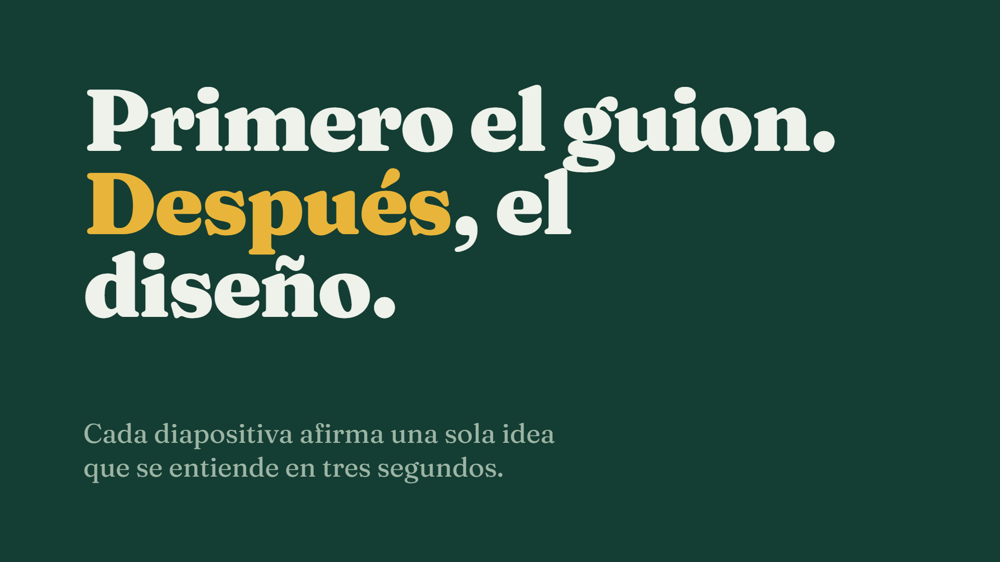
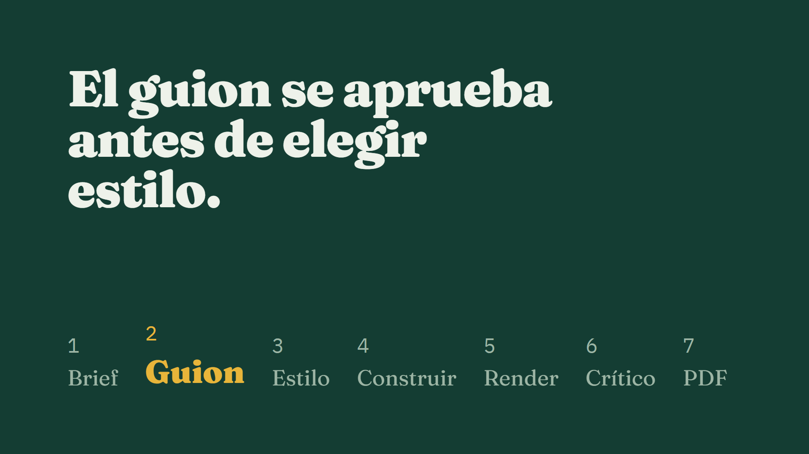

# presentaciones-web

Presentaciones web de un solo archivo, escritas con guion primero y estilo propio, que se revisan solas antes de presentarse.

**Web publicada:** https://ruubeenn13.github.io/presentaciones-web/



Cada deck vive en su carpeta, se presenta en el navegador sin conexión, se exporta a PDF de respaldo y se publica en su propia URL de GitHub Pages. Claude Code dirige el proceso con una skill del proyecto; la persona decide en cada paso.

## Cómo funciona



| Paso | Qué ocurre | Dónde queda |
|---|---|---|
| Brief | Público, duración, objetivo y la idea que deben recordar | `brief.md` |
| Guion | Una fila por diapositiva: titular que afirma, evidencia visual, nota del orador y segundos. Se aprueba antes de diseñar | `guion.md` |
| Estilo | Tres portadas muy distintas; se elige una y se fija paleta, tipografías y un único motivo visual | `design.md` |
| Construir | La presentación con [frontend-slides](https://github.com/zarazhangrui/frontend-slides) | `index.html`, `assets/` |
| Render | Captura de cada diapositiva a 1920x1080 y aviso de desbordes, cortes, solapes y texto pequeño | `renders/` |
| Crítico | Un subagente sin contexto de la conversación revisa brief, diseño y capturas, y devuelve solo fallos con arreglo | `.claude/agents/deck-critic.md` |
| PDF | Copia de respaldo, una página por diapositiva | `<deck>.pdf` |

Las reglas de contenido y diseño (titulares que afirman, 20 palabras por pantalla, texto de 30 pt, contraste 4,5:1, lista de recursos prohibidos) están en [`.claude/skills/presentaciones/SKILL.md`](.claude/skills/presentaciones/SKILL.md).

## Stack

- HTML, CSS y JavaScript sin dependencias en cada presentación; fuentes locales.
- Node.js 20+ y Playwright para capturas, comprobaciones y PDF.
- Claude Code con el plugin frontend-slides, una skill y un subagente propios.
- GitHub Actions y GitHub Pages para publicar.

## Crear un deck

```powershell
npm install
npx playwright install chromium

npm run nuevo-deck -- "Tema del deck"        # crea decks/AAAA-MM-tema-del-deck/
```

En Claude Code, pide la presentación («hazme una presentación sobre…»). La skill se activa sola y sigue el flujo. Al terminar:

```powershell
npm run render -- AAAA-MM-tema-del-deck      # capturas y comprobaciones
npm run pdf -- AAAA-MM-tema-del-deck         # PDF de respaldo
```

Un deck está terminado cuando el render no encuentra desbordes, el crítico no devuelve fallos y el PDF está exportado.

## Presentar

Abre `decks/<deck>/index.html` en el navegador y pulsa F11. Flechas, espacio o Re Pág / Av Pág para moverte. No necesita internet. Si el equipo falla, usa el PDF.

## Publicar

Cada push a `main` que toque `decks/` publica la web. Cada deck queda en su propia URL:

```
https://ruubeenn13.github.io/presentaciones-web/<deck>/
```

La raíz muestra la lista de decks con título y fecha.

## Estructura

```
decks/
  _plantilla/            plantilla que copia nuevo-deck
  AAAA-MM-tema/          brief.md, guion.md, design.md, index.html, assets/, renders/, PDF
scripts/                 nuevo-deck, render, pdf y build-site (Node + Playwright)
site/                    página índice de GitHub Pages
docs/                    deck de muestra y capturas de este README
.claude/
  skills/presentaciones/ proceso y reglas de estilo
  agents/deck-critic.md  revisor sin contexto
.github/workflows/       publicación en GitHub Pages
```

## Licencia

[MIT](LICENSE). Las fuentes Fraunces e IBM Plex Mono se distribuyen con la SIL Open Font License 1.1; sus licencias están junto a los archivos.
