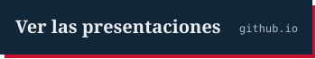

<a href="https://ruubeenn13.github.io/presentaciones-web/">
  
</a>

# presentaciones-web

Presentaciones web de un solo archivo. Cada una empieza por el guion, tiene un estilo que no se repite y pasa por un crítico antes de salir a escena. Se presentan en el navegador sin internet, se publican en su propia URL y llevan siempre un PDF de respaldo.

<p>
  <a href="https://ruubeenn13.github.io/presentaciones-web/"></a>&nbsp;&nbsp;
  <a href="#empezar-un-deck"></a>
</p>

## Siete pasos, siempre en el mismo orden

<picture>
  <source media="(prefers-color-scheme: dark)" srcset="docs/readme/flujo-oscuro.svg">
  
</picture>

El orden importa: el estilo no se elige hasta que el guion está aprobado, porque si una frase no se sostiene, ningún diseño la salva.

| | Paso | Qué ocurre | Queda en |
|:-:|---|---|---|
| 1 | **Brief** | Público, duración, objetivo y la única idea que deben recordar | `brief.md` |
| 2 | **Guion** | Una fila por diapositiva: titular que afirma algo, evidencia visual, nota del orador y segundos | `guion.md` |
| 3 | **Estilo** | Tres portadas muy distintas. Se elige una y se fijan paleta, tipografías y un único motivo visual | `design.md` |
| 4 | **Construir** | La presentación, con [frontend-slides](https://github.com/zarazhangrui/frontend-slides) | `index.html` |
| 5 | **Render** | Captura de cada diapositiva a 1920 × 1080 y aviso de desbordes, cortes, solapes y texto pequeño | `renders/` |
| 6 | **Crítico** | Un subagente que no ha visto la conversación revisa las capturas y devuelve solo fallos con su arreglo | `deck-critic` |
| 7 | **PDF** | La copia de respaldo, una página por diapositiva | `<deck>.pdf` |

## Empezar un deck

```powershell
npm install && npx playwright install chromium   # una sola vez
npm run nuevo-deck -- "Tema del deck"           # crea decks/AAAA-MM-tema-del-deck/
```

Después, en Claude Code: *«hazme una presentación sobre…»*. La skill del proyecto se activa sola y guía los siete pasos. Para cerrar:

```powershell
npm run render -- AAAA-MM-tema-del-deck   # capturas y comprobaciones
npm run pdf -- AAAA-MM-tema-del-deck      # PDF de respaldo
```

Un deck está terminado cuando el render no encuentra desbordes, el crítico no devuelve fallos y el PDF existe.

<details>
<summary><b>Presentar</b>: navegador, F11 y nada más</summary>
<br>

Abre `decks/<deck>/index.html` y pulsa **F11**. Te mueves con las flechas, la barra espaciadora o Re Pág y Av Pág, igual que con un mando de presentación.

Las fuentes van dentro de la carpeta del deck, así que funciona sin conexión. Si el ordenador del aula falla, el PDF está al lado.

</details>

<details>
<summary><b>Publicar</b>: cada deck en su propia URL</summary>
<br>

Cada push a `main` que toque `decks/` vuelve a publicar la web con GitHub Actions. Cada deck queda en:

```
https://ruubeenn13.github.io/presentaciones-web/<deck>/
```

La [página principal](https://ruubeenn13.github.io/presentaciones-web/) lista todos los decks con su título y su fecha; el más reciente ocupa toda la fila.

</details>

<details>
<summary><b>Decks web</b>: una web de scroll en vez de diapositivas</summary>
<br>

Un deck también puede ser una web de scroll hecha con Vite, con un modelo 3D (Three.js), animaciones guiadas por el scroll (GSAP y Lenis) y vídeos reales. Lo que lo distingue es que tiene su propio `package.json`. El primero es [`decks/2026-10-gymprofit-web`](decks/2026-10-gymprofit-web).

Sigue el mismo flujo y las mismas reglas, con cuatro diferencias:

- Cada escena es una `<section class="slide">`. Al ponerle `.active`, salta a su estado final, así que render, pdf y el crítico funcionan igual que con un deck de diapositivas. Lo hacen con movimiento reducido: cada escena es una pantalla con un fotograma fijo en vez del vídeo.
- Render, pdf y presentar construyen el deck antes (`npm run build` dentro de él) y usan esa versión, la misma que se publica.
- `npm run recorrido -- <deck>` graba un recorrido completo con movimiento normal en `renders/recorrido.webm`, para revisar las transiciones y los vídeos.
- Para presentar sin internet: `npm run presentar -- <deck>`. Construye el deck, lo sirve en `http://127.0.0.1:4321/` y abre el navegador.

Las grabaciones originales van en `grabaciones/` y no se suben. En `public/video/` solo van las editadas.

</details>

<details>
<summary><b>El crítico</b>: por qué revisa alguien que no ha visto nada</summary>
<br>

Quien acaba de hacer una diapositiva ve lo que quería hacer, no lo que hay. Por eso el crítico es un subagente sin acceso a la conversación: lee el brief, el diseño y las capturas, como lo vería el público.

Busca solo fallos que afecten al objetivo: una idea que no se entiende en tres segundos, titulares que nombran un tema en vez de afirmar algo, contraste por debajo de 4,5:1, texto por debajo de 30 pt, desbordes y solapes, colores o fuentes que no están en `design.md` y los tics que delatan una presentación hecha con IA. Nada de gustos personales. Como mucho, dos rondas de corrección.

Está en [`.claude/agents/deck-critic.md`](.claude/agents/deck-critic.md).

</details>

<details>
<summary><b>Las reglas</b>: lo que nunca aparece en un deck</summary>
<br>

| Siempre | Nunca |
|---|---|
| Una idea por diapositiva | Diapositivas solo de viñetas |
| Titulares que afirman («Las ventas cayeron por el horario») | Titulares que nombran un tema («Ventas») |
| 20 palabras o menos en pantalla | Líneas de acento bajo los títulos o franjas decorativas |
| Texto de 30 pt o más y contraste de 4,5:1 | Inter, Roboto o Arial por defecto |
| Un color dominante y un solo acento | Fondo crema con terracota o degradados morados |
| Maquetas variadas dentro de un sistema | La misma maqueta cinco veces |
| Movimiento solo donde algo cambia | Cada bloque entrando con un fundido |

La lista completa está en la skill: [`.claude/skills/presentaciones/SKILL.md`](.claude/skills/presentaciones/SKILL.md).

</details>

<details>
<summary><b>Estructura</b>: dónde está cada cosa</summary>
<br>

```
decks/
  _plantilla/             lo que copia nuevo-deck
  AAAA-MM-tema/           brief.md · guion.md · design.md · index.html · assets/ · renders/ · PDF
  AAAA-MM-tema-web/       igual, más package.json, src/, public/ y dist/ (construido, sin subir)
scripts/                  nuevo-deck, render, pdf, recorrido, presentar, build-decks y build-site
site/                     página principal de GitHub Pages
docs/                     deck de muestra e imágenes de este README
.claude/
  skills/presentaciones/  el proceso y las reglas de estilo
  agents/deck-critic.md   el revisor sin contexto
.github/workflows/        publicación en GitHub Pages
```

| Script | Qué hace |
|---|---|
| `npm run nuevo-deck -- "Tema"` | Copia la plantilla con la fecha y el nombre |
| `npm run render -- <deck>` | Captura cada diapositiva y falla si hay desbordes o texto cortado |
| `npm run pdf -- <deck>` | Exporta el PDF de respaldo |
| `npm run recorrido -- <deck>` | Graba un recorrido con movimiento normal (decks web) |
| `npm run presentar -- <deck>` | Sirve el deck construido sin internet y abre el navegador |
| `npm run build-decks` | Construye los decks web (`npm ci` y `npm run build` en cada uno) |
| `npm run build-site` | Monta la web con un índice y una carpeta por deck |

</details>

<details>
<summary><b>Así se ve un deck</b>: la muestra de <code>docs/ejemplo</code></summary>
<br>


Cada deck tiene su propia paleta y sus tipografías; esta es solo una muestra.

</details>

## Hecho con

HTML, CSS y JavaScript sin dependencias en cada presentación (Vite, Three.js, GSAP y Lenis en los decks web), Node.js y Playwright para capturas, comprobaciones y PDF, Claude Code con frontend-slides, una skill y un subagente propios, y GitHub Actions con GitHub Pages para publicar.

---

Licencia [MIT](LICENSE), hecho por [@ruubeenn13](https://github.com/ruubeenn13). Las fuentes Fraunces e IBM Plex Mono se distribuyen con la SIL Open Font License 1.1; sus licencias están junto a los archivos.
